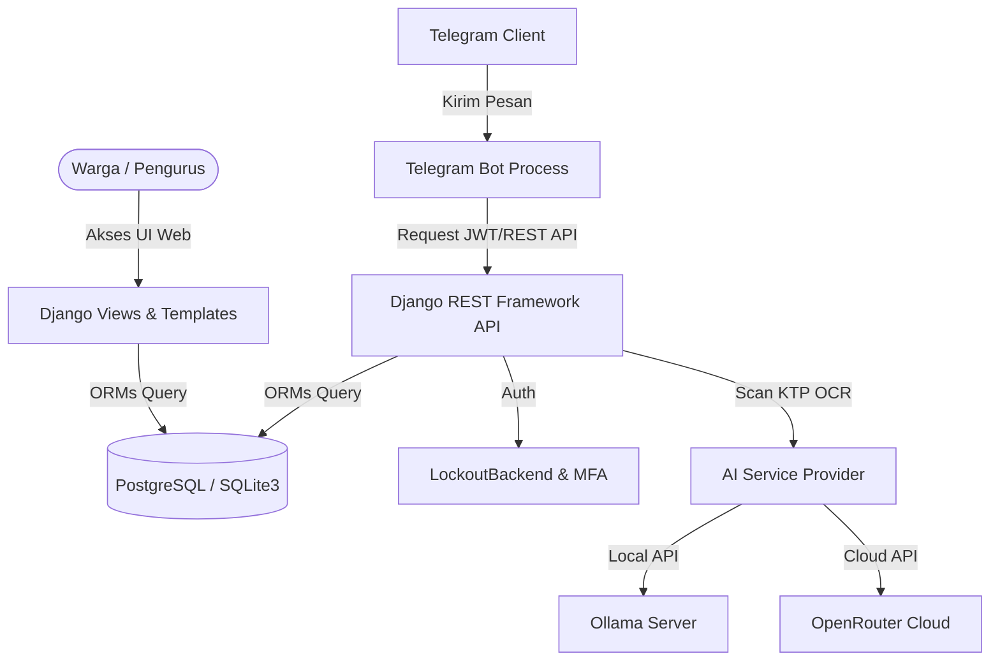
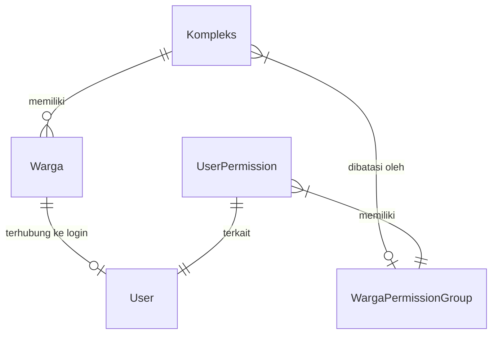
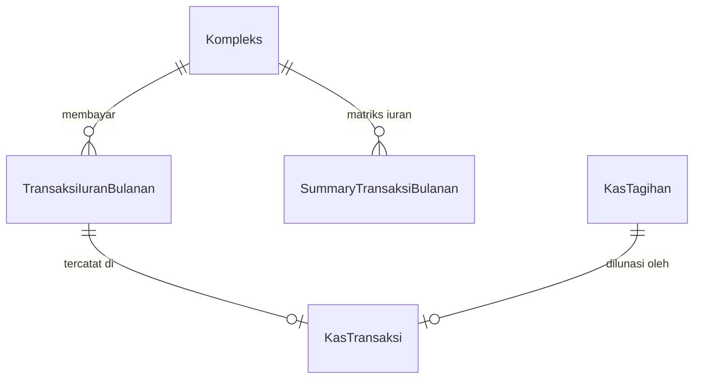

# Panduan Arsitektur & Model Database

Dokumen ini menjelaskan arsitektur sistem, struktur database (skema models), serta mekanisme otorisasi pembatasan akses data warga berdasarkan wilayah (Kompleks).

---

## 1. Arsitektur Sistem

Sistem DataWarga dirancang menggunakan Django Web Framework dengan pendekatan Monolitik Model-Template-View (MTV) untuk user-interface admin, serta dilengkapi dengan REST API menggunakan Django REST Framework (DRF) untuk keperluan interaksi dengan Telegram Bot dan sistem eksternal.

Berikut gambaran alur komponen sistem:

### Komponen Utama:
- **Django Views**: Melayani halaman manajemen admin, dashboard iuran, kas, dan surat-menyurat dengan bootstrap UI.
- **Django REST Framework (DRF)**: Menyediakan endpoint API berproteksi JWT untuk aplikasi bot dan integrasi. Dilengkapi auto-generated Swagger API docs (`/swagger/` dan `/redoc/`).
- **Custom Authentication Backend**: `LockoutBackend` untuk proteksi brute force login serta modul otentikasi MFA.
- **AI Service Wrapper**: Mengabstraksi penyedia model vision OCR KTP sehingga mendukung Ollama lokal maupun OpenRouter cloud.

---

## 2. Struktur Model Database

Berikut adalah penjelasan rinci mengenai model-model data yang didefinisikan dalam [models.py](file:///Users/robertusnegoro/workingdir/repo/datawarga/datawarga/kependudukan/models.py):

### A. Modul Kependudukan (Warga & Kompleks)

1. **`Warga`**:
   Mewakili entitas individu penduduk.
   - `nama_lengkap` (CharField): Nama lengkap warga (secara otomatis disinkronisasi ke uppercase saat disimpan untuk konsistensi).
   - `nik` (CharField, Unique): Nomor Induk Kependudukan (16 digit).
   - `no_kk` (CharField): Nomor Kartu Keluarga.
   - `email` & `no_hp`: Data kontak warga.
   - `pekerjaan` (CharField): Pilihan pekerjaan (PNS, Swasta, BUMN, Wiraswasta, Pelajar, dll).
   - `status` (CharField): Status pernikahan (Belum Kawin, Kawin, Cerai).
   - `status_tinggal` (CharField): Status menetap (Tetap, Kontrak, Kost, Pindah, Meninggal).
   - `status_keluarga` (CharField): Hubungan keluarga (Suami, Istri, Anak, Orang Tua, dll).
   - `kepala_keluarga` (BooleanField): Menandakan apakah warga tersebut adalah Kepala Keluarga di rumah tersebut.
   - `kompleks` (ForeignKey -> `Kompleks`): Menghubungkan warga ke alamat rumah tempat tinggal.
   - `user` (OneToOneField -> `User`): Menghubungkan warga ke akun login portal jika ada.
   - `foto_path` & `ktp_image_path`: Unggahan foto wajah dan foto KTP warga.

2. **`Kompleks`**:
   Mewakili entitas unit rumah/alamat tinggal dalam kompleks RT/RW.
   - `blok` (CharField) & `nomor` (CharField): Identitas utama rumah (e.g. Blok J2 Nomor 5).
   - `cluster` (CharField): Nama kluster perumahan jika ada.
   - `rt` & `rw`: Alamat RT/RW setempat.
   - `permission_group` (ForeignKey -> `WargaPermissionGroup`): Menentukan grup pengurus mana yang memiliki hak mengelola data rumah ini.

---

### B. Modul Keuangan (Iuran & Kas Buku)

3. **`TransaksiIuranBulanan`**:
   Mencatat riwayat pembayaran iuran wajib bulanan yang dilakukan oleh masing-masing unit Kompleks.
   - `kompleks` (ForeignKey -> `Kompleks`): Rumah yang membayar iuran.
   - `periode_bulan` (IntegerField): Bulan periode iuran (1 = Januari s/d 12 = Desember).
   - `periode_tahun` (IntegerField): Tahun periode iuran.
   - `total_bayar` (IntegerField): Jumlah nominal yang dibayar.
   - `bukti_bayar` (FileField): Unggahan bukti transfer/pembayaran warga.
   - `status` (CharField): Status verifikasi pembayaran (PENDING, APPROVED, REJECTED).

4. **`SummaryTransaksiBulanan`**:
   Tabel ringkasan/matriks pembayaran iuran bulanan per rumah dalam satu tahun tertentu. Memiliki field Boolean untuk setiap bulan (`january` s/d `december`) untuk menampilkan tabel checklist pembayaran iuran secara cepat di dashboard admin.

5. **`KasTagihan`**:
   Mencatat kewajiban bayar (hutang) atau hak terima dana (piutang) pihak RT/RW ke pihak ketiga.
   - `jenis` (CharField): Pilihan `HUTANG` atau `PIUTANG`.
   - `kategori` (CharField): Kategori tagihan (Iuran, Sosial, Kebersihan, Keamanan, Operasional, Pembangunan).
   - `jumlah` (IntegerField): Nominal tagihan.
   - `tanggal_jatuh_tempo` (DateField): Batas akhir pembayaran.
   - `status` (CharField): `BELUM` atau `LUNAS`.

6. **`KasTransaksi`**:
   Buku kas ledger utama keuangan RT/RW. Mencatat seluruh arus kas masuk (`PEMASUKAN`) dan kas keluar (`PENGELUARAN`).
   - `jenis` (CharField): `PEMASUKAN` atau `PENGELUARAN`.
   - `jumlah` (IntegerField): Nominal transaksi.
   - `iuran_asal` (ForeignKey -> `TransaksiIuranBulanan`): Jika transaksi masuk berasal dari pembayaran iuran warga, entitas ini otomatis terhubung.
   - `tagihan_asal` (ForeignKey -> `KasTagihan`): Jika transaksi merupakan pelunasan tagihan hutang/piutang.

---

### C. Modul Layanan Mandiri Warga

7. **`Surat`**:
   Pencatatan permohonan dan penerbitan surat pengantar resmi.
   - `warga` (ForeignKey -> `Warga`): Penduduk pemohon surat.
   - `jenis_surat` (CharField): `PENGANTAR_RT`, `KETERANGAN_DOMISILI`, atau `KETERANGAN_TIDAK_MAMPU`.
   - `nomor_surat` (CharField): Nomor surat resmi dari pengurus.
   - `keperluan` (TextField): Alasan/tujuan pembuatan surat.
   - `penandatangan` (ForeignKey -> `Penandatangan`): Pejabat RT/RW yang menandatangani dokumen.

8. **`Kendaraan`**:
   Pencatatan data kendaraan bermotor milik warga untuk database keamanan lingkungan.
   - `plat_nomor` (CharField, Unique): Nomor polisi kendaraan.
   - `jenis_kendaraan` (CharField): `MOBIL`, `MOTOR`, atau `LAINNYA`.
   - `pemilik` (ForeignKey -> `Warga`).

9. **`WargaUpdateRequest`**:
   Menampung perubahan data profil warga yang diajukan secara mandiri melalui Portal Warga. Perubahan data disimpan dalam bentuk format JSON di field `data_changes` dan menunggu persetujuan admin untuk diaplikasikan ke model `Warga` utama.

---

### D. Modul Autentikasi & Profil Keamanan

10. **`UserProfile`**:
    Menyimpan data profil tambahan user akun Django.
    - `foto` (ImageField): Foto profil user.
    - `failed_login_attempts` (IntegerField): Jumlah kegagalan login berturut-turut.
    - `shadow_ban_expires_at` (DateTimeField): Batas waktu ban sementara jika batas kegagalan login terlewati.
    - `is_permanently_locked` (BooleanField): Status akun terkunci permanen.
    - `mfa_enabled` & `totp_secret`: Pengaturan autentikasi dua faktor (MFA).

11. **`UserInvitation`**:
    Token undangan pendaftaran akun login untuk warga baru. Warga mengklik tautan berisi token unik (`/accounts/invite/<token>/`) untuk mengaktifkan akun dan membuat password baru.

---

## 3. Mekanisme Segregasi Data (Multi-RT/RW)

Sistem DataWarga menerapkan segregasi data multi-wilayah. Hal ini memastikan bahwa pengurus RT 01 hanya dapat melihat, menambah, dan mengubah data warga atau iuran di lingkungan RT 01, sedangkan pengurus RT 02 mengelola lingkungannya sendiri.

### Cara Kerja Segregasi Data:
1. Admin membuat **`WargaPermissionGroup`** (misal: "Grup RT 01").
2. User pengurus RT 01 dihubungkan ke grup tersebut via tabel **`UserPermission`**.
3. Rumah-rumah (unit Kompleks) di wilayah RT 01 disetel field `permission_group`-nya ke "Grup RT 01".
4. Pada level queries (di views admin/API), sistem akan memfilter objek Kompleks yang memiliki `permission_group` yang sama dengan user yang sedang aktif. Warga yang berada di rumah tanpa grup yang cocok tidak akan muncul dalam daftar pencarian maupun laporan iuran user tersebut.
